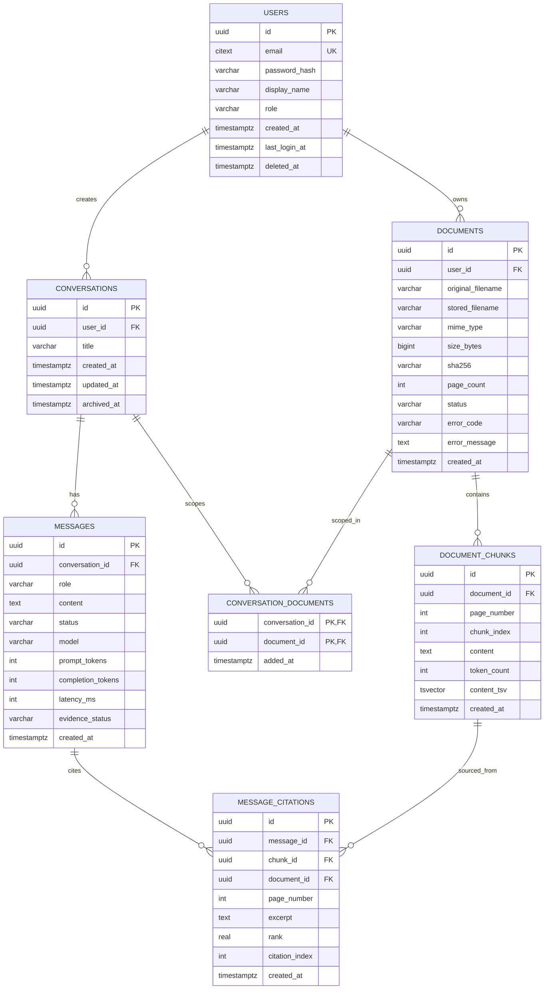
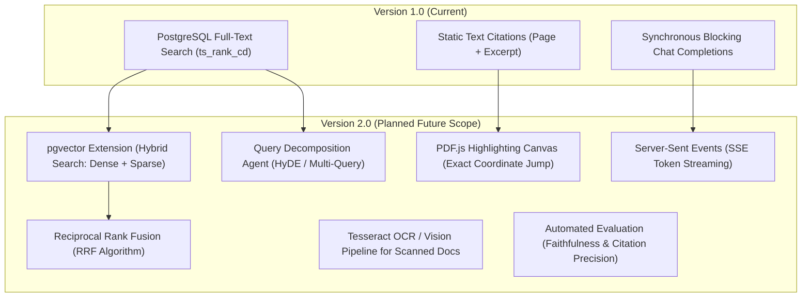

# VerityAI — Architecture & System Design

**Document Version:** 1.0.0  
**Status:** Approved for Implementation  
**Target Systems:** Windows 10/11 (Development), Ubuntu Server 24.04 LTS (Self-Hosted) / AWS EC2 (Cloud)  

---

## 1. System Overview

**VerityAI** is an evidence-grounded AI research assistant designed around the core principle of **provable provenance**: every claim synthesized by the Large Language Model (LLM) must be traceable back to specific pages and text chunks within user-uploaded documents (PDFs).

### Core Architectural Principles
1. **Zero Uncited Assertions**: Answers are bound to retrieved passages. The model must refuse to speculate and explicitly report insufficient evidence when reference material is missing.
2. **Enterprise Layering**: Separation of concerns across Presentation (React SPA), API & Domain (Spring Boot 3 / Java 21), Persistence (PostgreSQL 17), and External AI (Groq via native `HttpClient`).
3. **No Heavy AI Frameworks**: Built without bulky framework wrappers (e.g., Spring AI or LangChain4j), ensuring direct control over HTTP timeouts, memory footprint, retries, and serialization.
4. **Data Isolation & Tenant Security**: All document chunks, conversations, and search queries are strictly isolated by `user_id` at the database query level.

---

## 2. High-Level Architecture Diagram

```mermaid
graph TD
    subgraph Client ["Client Tier (Browser)"]
        SPA["React 18 SPA<br/>(Vite + TypeScript + Tailwind)"]
        Cache["TanStack Query Cache"]
        Forms["React Hook Form + Zod"]
    end

    subgraph Edge ["Edge & Reverse Proxy Tier"]
        CF["Cloudflare Tunnel (cloudflared)<br/>OR AWS ALB"]
        Nginx["Nginx Reverse Proxy<br/>- SSL Termination<br/>- Static Asset Serving<br/>- Gzip/Brotli Compression"]
    end

    subgraph BackendApp ["Application Tier (Spring Boot 3 / Java 21)"]
        SecFilter["Spring Security Filter Chain<br/>(Session Cookie + CSRF Header)"]
        RestControllers["REST Controllers (/api/v1)"]
        DocService["DocumentService<br/>- PDFBox 3 Text Extraction<br/>- Sliding Window Chunking"]
        RetService["RetrievalService<br/>- PostgreSQL FTS ts_rank_cd"]
        ChatService["ChatService<br/>- Prompt & Evidence Assembly<br/>- Citation Reverse Mapping"]
        GroqService["GroqLlmService<br/>- Java 21 HttpClient<br/>- Jackson Parsing"]
    end

    subgraph DataTier ["Persistence & External Services"]
        PG[("PostgreSQL 17<br/>- Spring Session JDBC<br/>- Documents, Chunks, Citations<br/>- GIN Index on content_tsv")]
        FS["Encrypted File Store<br/>uploads/ (Outside Webroot)"]
        GroqAPI["Groq Cloud API<br/>(Llama 3.3 / Mixtral / gpt-oss)"]
    end

    SPA -->|HTTPS / JSON + Credentials| CF
    CF --> Nginx
    Nginx -->|/ (Static Files)| SPA
    Nginx -->|/api/* (Reverse Proxy)| SecFilter
    SecFilter --> RestControllers
    RestControllers --> DocService
    RestControllers --> RetService
    RestControllers --> ChatService
    ChatService --> RetService
    ChatService --> GroqService
    DocService -->|Store Binary| FS
    DocService -->|Store Metadata & Chunks| PG
    RetService -->|FTS Search Queries| PG
    GroqService -->|HTTPS POST Completions| GroqAPI
```

---

## 3. Frontend Architecture

### 3.1 Technology Stack
* **Core Framework**: React 18.3 + TypeScript 5.6 running on Vite 5.4.
* **Styling & UI**: Tailwind CSS 3.4, Lucide React icons, Radix UI toast primitives, class-variance-authority (`cva`).
* **State & Data Synchronization**: `@tanstack/react-query` v5 for server-state caching, automatic cache invalidation, and optimistic UI updates.
* **Routing**: `react-router-dom` v6 with layout routing, protected route guards (`ProtectedRoute`), and unauthenticated redirection (`PublicRoute`).
* **Forms & Validation**: `react-hook-form` with `zod` schema resolvers.
* **Content Rendering**: `react-markdown` with `remark-gfm` for tables, quotes, and code blocks.

### 3.2 Component Hierarchy
```
App.tsx
├── ThemeProvider (Dark / Light mode)
├── Routes
│   ├── LandingPage (Public overview, features, hero)
│   ├── LoginPage & RegisterPage (PublicRoute)
│   └── Layout (ProtectedRoute with Collapsible Sidebar)
│       ├── DashboardPage (Recent research, quick uploads, status summaries)
│       ├── DocumentsPage (Dropzone upload, file table, status filters)
│       ├── DocumentDetailPage (Chunk inspection, reprocessing retry)
│       ├── WorkspacePage (Conversation list, multi-document selection, creator)
│       ├── ConversationPage (Chat stream, message bubbles, citation drawer)
│       └── SettingsPage (Profile, password change, account management)
```

### 3.3 Client-Side Security & CSRF Interception
Communication with the backend uses standard browser cookies (`HttpOnly; SameSite=Lax`). Mutating operations (`POST`, `PUT`, `PATCH`, `DELETE`) are protected by the Double Submit Cookie pattern:
* The [`ApiClient`](file:///C:/Users/iamab/VerityAI/frontend/src/lib/api.ts) checks for the presence of the `XSRF-TOKEN` cookie.
* If missing, it queries `GET /api/v1/auth/csrf` to initialize the token.
* On every mutating request, the token is attached to the `X-XSRF-TOKEN` header.
* If a request receives a `403 Forbidden` due to session or CSRF token expiration, `ApiClient` automatically clears the stale token, requests a fresh token, and retries the mutation once.

---

## 4. Backend Architecture

### 4.1 Layered Design Pattern
The backend adheres strictly to a 4-tier hexagonal-inspired layered architecture:

```
com.verityai
├── config/              # Security, CORS, WebMvc, Async Executors
├── controller/          # Clean REST endpoints; validates input, delegates to services
├── dto/                 # Request records & Response records (Zero entity leakage)
├── entity/              # JPA Domain models with Hibernate annotations
├── repository/          # Spring Data JPA interfaces + Native SQL FTS queries
├── service/             # Pure transactional business logic
│   ├── ai/              # GroqLlmService, ChatService, Prompt engineering
│   ├── document/        # DocumentService, PDFBox parsing, Chunking
│   └── retrieval/       # RetrievalService, Ranking, Evidence thresholds
├── exception/           # Custom ApiException, GlobalExceptionHandler, ErrorCode
└── util/                # RequestIdFilter, HashUtils, Pagination helpers
```

### 4.2 PDF Processing & Ingestion Pipeline
1. **Multipart Upload Validation**:
   * Inspects magic bytes (must start with `%PDF-`).
   * Enforces file size limits ($\le 25\text{MB}$) and page limits ($\le 200\text{ pages}$).
   * Generates a unique stored filename (`UUID.pdf`) in a private filesystem folder (`uploads/`).
   * Computes SHA-256 checksum to prevent redundant document processing.
2. **Transaction-Safe Asynchronous Trigger (`runAfterCommit`)**:
   * To prevent race conditions where a background worker executes before PostgreSQL has committed the document record, processing is hooked into Spring's `TransactionSynchronizationManager.afterCommit()`.
3. **Extraction & Chunking**:
   * Apache PDFBox 3.0 parses each page.
   * A sliding-window algorithm segments the text into chunks of `1,000` characters with a `150`-character overlap to ensure continuous semantic context across boundaries.
   * Each chunk preserves: `document_id`, `page_number`, `chunk_index`, and raw `content`.
   * Chunks are batch-saved via JPA. PostgreSQL's generated column `content_tsv` computes the full-text search vector automatically.

### 4.3 Retrieval-Augmented Generation (RAG) Engine
* **Native PostgreSQL FTS Indexing**:
  * Chunks utilize `tsvector GENERATED ALWAYS AS (to_tsvector('english', content)) STORED`.
  * Indexed with a GIN (Generalized Inverted Index) for sub-millisecond retrieval across millions of tokens.
* **Retrieval Querying**:
  * Utilizes `websearch_to_tsquery('english', :query)` to safely sanitize user queries (supporting quotes and logical operators without SQL syntax errors).
  * Ranked via `ts_rank_cd(content_tsv, query)` (Cover Density ranking), prioritizing chunks where search terms appear in close proximity.
  * Thresholding: Results with rank $< 0.01$ are dropped to eliminate irrelevant noise.
* **Document Scoping**:
  * If a user queries within a conversation configured with specific documents, the retrieval query filters strictly on `d.id IN (:documentIds)`.

### 4.4 Direct Groq Integration (`GroqLlmService`)
* **Transport**: Java 21 `java.net.http.HttpClient` with an HTTP/2 transport layer.
* **Configuration**:
  * Connection timeout: 10,000ms.
  * Read timeout: 60,000ms.
  * Max retries: 2 (with bounded exponential backoff on HTTP 429 and 503).
* **System Prompting & Citation Rules**:
  * Injects retrieved passages formatted as `Source [S1] (Document: doc.pdf, Page: 4): ...`.
  * System rule: *"Answer using ONLY the provided evidence. Cite every claim using [S1], [S2]. If the evidence is insufficient, state: 'Insufficient evidence to answer.' Do not hallucinate."*
* **Response Processing**:
  * Jackson parses the JSON completion payload.
  * Regex extracts cited indices (`\[S(\d+)\]`).
  * `ChatService` links each referenced index to its original `DocumentChunk` and persists a `MessageCitation` entity.

---

## 5. Database Schema & Data Models

### 5.1 Entity-Relationship Diagram



---

## 6. Security & Authorization Architecture

1. **Session Management**:
   * Uses Spring Session JDBC (`spring_session` tables).
   * Cookies configured with: `HttpOnly=true`, `SameSite=Lax`, `Secure` (in production).
   * Session inactivity timeout: 30 minutes.
2. **Access Control & Multi-Tenancy**:
   * No user can read, query, delete, or retrieve citations for documents they do not own.
   * Every SQL query filters by `user_id = :currentUserId`.
3. **Password Security**:
   * Passwords hashed using `BCryptPasswordEncoder` with work factor 12.
4. **Input Sanitization**:
   * PDF file streams validated by magic numbers.
   * User prompt inputs bound strictly as parameters in Groq user messages, never executed as instructions.

---

## 7. Deployment Architecture (Dual Path)

### Path A: Repurposed 8GB Laptop (Ubuntu Server 24.04 LTS)
* **OS**: Headless Linux (no GUI), consuming $<400\text{MB}$ RAM.
* **Containerization**: Native Docker Engine running PostgreSQL 17.
* **Process Manager**: Systemd manages the compiled Spring Boot `.jar` service (`verityai.service`).
* **Web Server**: Nginx serves the compiled frontend assets directly from `/var/www/verityai/dist` and proxies `/api` to `localhost:8080`.
* **Public Access**: Cloudflare Tunnel (`cloudflared`) connects outbound to Cloudflare's edge network, bypassing CGNAT and dynamic IPs with zero router port forwarding and providing free SSL.

### Path B: AWS EC2 (Ubuntu 24.04 / `t3.small`)
* Standard Docker Compose orchestrating Nginx, PostgreSQL, and Spring Boot behind an AWS Security Group restricting all ports except 80, 443, and SSH (key-based).

---

## 8. Comprehensive Future Scope Architecture

The architecture is built with clear extension points for subsequent releases:



### 8.1 Hybrid Retrieval (`pgvector` + Lexical Search with RRF)
* **Goal**: Overcome full-text search vocabulary mismatch (synonyms) while retaining exact keyword precision.
* **Design**:
  * Install `pgvector` in PostgreSQL.
  * Add column `embedding vector(384)` or `vector(768)` to `document_chunks`.
  * Compute dense embeddings using a local HuggingFace/ONNX model (e.g., `all-MiniLM-L6-v2`) or Groq/Embeddings API.
  * Combine keyword rank $R_{FTS}$ and vector cosine similarity $R_{Vector}$ using Reciprocal Rank Fusion:
    $$RRF\_Score(d) = \frac{1}{60 + R_{FTS}(d)} + \frac{1}{60 + R_{Vector}(d)}$$

### 8.2 In-Browser PDF Visual Highlighting (Exact Coordinate Mapping)
* **Goal**: When a user clicks `[S1]`, display the original PDF inside the browser, auto-scroll to the exact page, and render a yellow bounding-box highlight over the cited sentences.
* **Design**:
  * Update `DocumentService` to record character bounding boxes $(x, y, w, h)$ during PDFBox extraction.
  * Integrate `@react-pdf-viewer/core` or `pdfjs-dist` into `ConversationPage.tsx`.
  * Pass citation coordinate arrays to the frontend to draw Canvas overlays on the rendered PDF page.

### 8.3 Real-Time Token Streaming (Server-Sent Events)
* **Goal**: Deliver immediate time-to-first-token ($<400\text{ms}$) rather than waiting for full completion.
* **Design**:
  * Switch Groq API request to `"stream": true`.
  * Expose `GET /api/v1/conversations/{id}/messages/stream` using Spring WebFlux `Flux<ServerSentEvent<String>>` or `ResponseBodyEmitter`.
  * Stream delta tokens to the frontend while buffering citation tokens (`[S1]`) to resolve citations dynamically as the stream finishes.

### 8.4 Multi-Hop & Agentic RAG
* **Goal**: Answer complex comparative questions across multiple documents (e.g., *"Compare the revenue growth between Document A and Document B"*).
* **Design**:
  * Ingest a lightweight Query Planner that decomposes the user prompt into sub-queries.
  * Run parallel retrieval passes for each sub-query.
  * Synthesize multi-source evidence into a cohesive answer with multi-document citations.

### 8.5 Automated Quantitative Evaluation Harness
* **Goal**: Academic benchmark reporting (Faithfulness, Citation Precision, Hallucination Rate).
* **Design**:
  * Integration with the Ragas / TruLens evaluation framework.
  * Automated testing script evaluating 50 standardized question-document pairs, computing:
    * **Context Relevance**: $\frac{|\text{Relevant Chunks}|}{|\text{Retrieved Chunks}|}$
    * **Groundedness / Faithfulness**: $\frac{|\text{Verified Claims}|}{|\text{Total Claims Made}|}$
    * **Citation Precision**: $\frac{|\text{Accurate Citations}|}{|\text{Total Generated Citations}|}$
