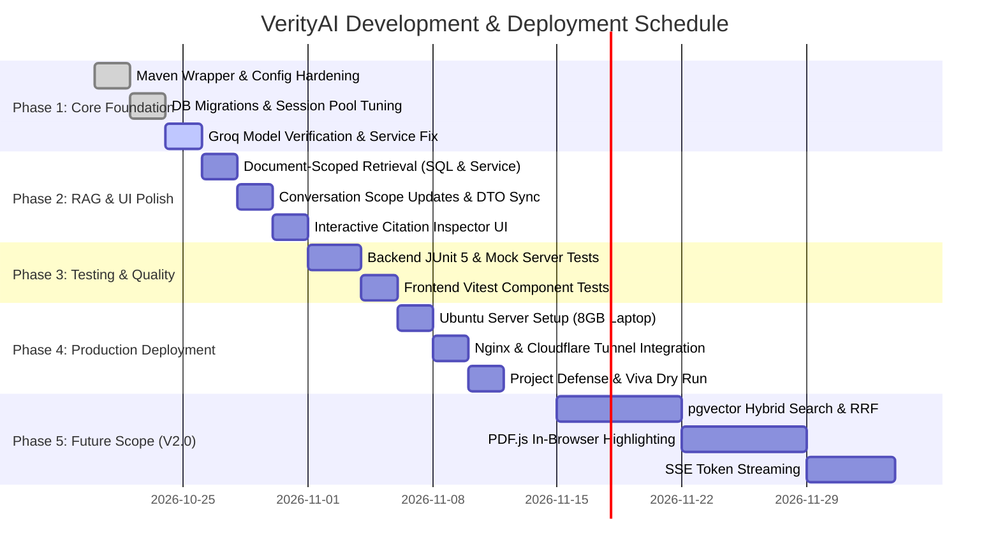

# VerityAI — Comprehensive Project Plan & Management Guide

**Project Title:** VerityAI — Evidence-Based AI Research Assistant  
**Author / Lead:** Senior Engineering & DevOps Lead  
**Document Version:** 1.0.0  
**Project Category:** Enterprise Full-Stack Engineering & Applied AI  

---

## 1. Executive Summary & Problem Statement

### 1.1 The Problem
Generative AI models are notorious for **hallucinations**: generating plausible-sounding facts, fabricated quotes, and fictitious references with high confidence. In high-stakes fields—such as academic research, legal discovery, clinical trials, and financial auditing—unsubstantiated claims make standard LLM chatbots dangerous and unusable.

### 1.2 The Solution
**VerityAI** (*"Answers you can verify"*) enforces mathematical and semantic grounding on all AI responses. Users upload unstructured research papers and technical PDFs, and every assertion generated by the system is explicitly tethered to specific document chunks, page numbers, and relevance ranks. The system explicitly reports insufficient evidence when the source material is lacking, eliminating unwarranted speculation.

---

## 2. Target Personas & Primary User Journeys

| Persona | Needs & Goals | How VerityAI Solves It |
|---|---|---|
| **Academic Researcher / Student** | Synthesizing literature across multiple papers; checking peer-reviewed claims; finding exact page numbers for bibliography references. | Extracts multi-page text, indexes via FTS, highlights exact page numbers and quotes for instant verification. |
| **Legal / Compliance Analyst** | Analyzing contractual clauses, compliance policies, or audit manuals where every claim must be legally defensible. | Enforces strict `[S1]`, `[S2]` citation indices with relevance scores; warns if evidence is insufficient. |
| **Technical Engineer** | Querying dense API specifications, architecture standards, or hardware manuals without reading 400-page PDFs. | Sub-millisecond keyword and context retrieval using PostgreSQL GIN indexing without cloud vendor lock-in. |

---

## 3. Scope Management

### 3.1 In-Scope (Phase 1 & Phase 2 — Production V1.0)
* **Frontend**:
  * Public landing page detailing evidence-based RAG and security features.
  * Multi-theme UI (Dark and Light modes) with responsive sidebar layout.
  * Drag-and-drop PDF upload with progress and error indicators.
  * Document library with status filtering (`UPLOADED`, `PROCESSING`, `READY`, `FAILED`), search, and retry triggers.
  * Workspace chat interface with Markdown formatting and interactive citation drawers.
  * User profile management and password rotation.
* **Backend**:
  * Spring Boot 3 + Java 21 REST API (`/api/v1`).
  * Spring Security session-based auth with JDBC backing and CSRF protection.
  * Apache PDFBox text extraction and sliding-window chunking.
  * Native PostgreSQL full-text search with `ts_rank_cd` scoring and document scoping.
  * Direct Groq LLM integration using Java 21 `HttpClient` and Jackson.
  * Systematic exception handling, request correlation IDs (`X-Request-ID`), and health actuators.
* **Deployment**:
  * Production Docker Compose configuration.
  * Setup guides for Ubuntu Server on repurposed 8GB hardware and AWS EC2.
  * Nginx reverse proxy with Cloudflare Tunnel (zero-port-forwarding SSL).

### 3.2 Out-of-Scope (V1.0 Initial Release)
* Processing file types other than PDF (e.g., DOCX, EPUB, audio transcription).
* Scanned document OCR (requires external Tesseract/Vision pipeline).
* Collaborative multi-user team workspaces (single-user tenancy in V1).

---

## 4. Work Breakdown Structure (WBS) & Milestones



### Milestone Breakdown

#### Milestone 1: Environment & Foundation Hardening
* **Deliverables**:
  * Regenerate clean Maven wrapper (`mvnw.cmd`).
  * Verify Groq API connectivity with an available model (e.g., `llama-3.3-70b-versatile` or `llama-3.1-8b-instant`).
  * Tune HikariCP connection pool settings in `application.yml` (`max-lifetime`, `connection-timeout`, `keepalive-time`) to prevent idle connection dropouts.
  * Start backend on `http://localhost:8080` alongside frontend on `http://localhost:5173`.
* **Success Criteria**: Actuator `/actuator/health` returns `UP`; user can register and log in via the React UI.

#### Milestone 2: RAG Pipeline & Scoped Retrieval
* **Deliverables**:
  * Add document-scoping parameters to `DocumentChunkRepository.fullTextSearchWithRank`.
  * Implement document scoping logic in `RetrievalService` and `ChatService`.
  * Wire the conversation document scope selector in `WorkspacePage.tsx` and `ConversationController.update`.
  * Validate edge cases in PDF extraction (empty pages, corrupt headers, oversize files).
* **Success Criteria**: When a user selects 2 specific PDFs in a workspace, answers are retrieved exclusively from those 2 PDFs.

#### Milestone 3: Research Workspace & Citation UI Polish
* **Deliverables**:
  * Interactive citation side-panel or popover displaying document name, page number, relevance percentage, and exact excerpt.
  * Visual evidence sufficiency badges (`Sufficient Evidence` in green, `Insufficient Evidence` in amber).
  * Copy-answer and Markdown code block rendering enhancements.
* **Success Criteria**: Clicking any `[S1]` citation smoothly opens the citation inspector highlighting the underlying evidence.

#### Milestone 4: Testing & Verification Gate
* **Deliverables**:
  * Backend JUnit 5 tests covering services, security, chunking, and mock Groq API responses.
  * Frontend Vitest unit tests for auth forms, document dropzone, and citation rendering.
  * End-to-end user verification checklist.
* **Success Criteria**: Clean test execution with zero failures (`mvn test` and `npm test`).

#### Milestone 5: Production Deployment & Viva Preparation
* **Deliverables**:
  * Setup runbook for repurposed 8GB laptop running Ubuntu Server 24.04 LTS.
  * Production Docker Compose and Nginx configuration.
  * Cloudflare Tunnel integration for zero-cost HTTPS public access.
  * Project defense presentation deck and demonstration script.
* **Success Criteria**: Publicly accessible HTTPS URL functioning reliably from an external network.

---

## 5. Hardware & Infrastructure Strategy

### Option A (Recommended): Repurposed 8GB Laptop (Linux Server)
* **Operating System**: Ubuntu Server 24.04 LTS (Headless / Minimal).
* **Hardware Utilization**:
  * OS Core: ~300 MB RAM.
  * PostgreSQL 17 (Docker): ~200 MB RAM.
  * Spring Boot 3 (`-Xmx768m`): ~768 MB RAM.
  * Nginx (Reverse Proxy & Static Files): ~25 MB RAM.
  * **Total Footprint**: ~1.3 GB – 1.8 GB out of 8 GB RAM.
  * **Headroom**: Over 6 GB of free RAM remaining for disk caching and future expansions.
* **Cost**: **$0.00 / ₹0.00** (Uses existing hardware and free Cloudflare Tunnels).
* **Reliability Advantage**: Laptop battery acts as a built-in UPS, preventing crashes during short power interruptions.

### Option B: AWS EC2 Cloud Hosting
* **Instance Type**: `t3.small` (2 vCPU, 2GB RAM).
* **Cost**: ~$15/month after free tier expiration.
* **Resource Constraint**: Tight memory envelope requiring JVM heap restriction (`-Xmx512m`) and a 2GB swapfile.

---

## 6. Risk Management Matrix

| Risk Event | Severity | Likelihood | Mitigation Strategy |
|---|---|---|---|
| **Groq Model Deprecation / Rate Limit** | High | Medium | Keep model configurable in `.env`; implement exponential backoff on HTTP 429; provide instant fallback to alternative Groq models (`llama-3.1-8b-instant`). |
| **Home ISP CGNAT / Dynamic IP** | High | High | Use Cloudflare Tunnel (`cloudflared`). Completely bypasses router port forwarding and CGNAT; establishes outbound HTTPS tunnel to Cloudflare edge. |
| **Power or Wi-Fi Failure on Viva Day** | Critical | Low | Keep the server on the laptop itself. Bring the physical laptop to college, connect presentation device and laptop to a portable mobile hotspot, and demo locally. |
| **Corrupt / Scanned Image PDFs** | Medium | Medium | Validate PDF stream before extraction; report clear status `FAILED` with descriptive error code (`SCANNED_PDF_NO_TEXT`) rather than crashing. |
| **PostgreSQL Connection Pool Stale Timeouts** | Medium | Medium | Configure HikariCP `max-lifetime: 1800000`, `connection-timeout: 30000`, and `keepalive-time: 30000` to refresh connections automatically after system sleeps. |

---

## 7. Comprehensive Future Scope Roadmap (V2.0 & Beyond)

```
┌─────────────────────────────────────────────────────────────────────────┐
│                           VerityAI Evolution                            │
├─────────────────────────┬────────────────────────┬──────────────────────┤
│       Phase 1 & 2       │        Phase 3         │      Phase 4 & 5     │
│       Current V1.0      │       Near-Term        │      Future Scope    │
├─────────────────────────┼────────────────────────┼──────────────────────┤
│ • PostgreSQL FTS        │ • Hybrid Search        │ • Multi-Agent RAG    │
│ • Text Excerpt Citation │   (pgvector + BM25)    │ • Graph RAG          │
│ • Groq Llama 3.3 Batch  │ • In-Browser PDF.js    │ • Vision OCR Engine  │
│ • Single User Scoping   │   Visual Highlighting  │ • Multi-Doc Synthesis│
│ • Session Auth & CSRF   │ • SSE Token Streaming  │ • Legal/Med Adapters │
└─────────────────────────┴────────────────────────┴──────────────────────┘
```

### 7.1 Hybrid Dense-Sparse Retrieval (`pgvector` + FTS)
* **Motivation**: Full-text search struggles when queries use semantic synonyms (e.g., searching for *"revenue"* when the document says *"turnover"*).
* **Implementation Plan**:
  1. Add `CREATE EXTENSION vector;` via a Flyway migration (`V3__add_pgvector.sql`).
  2. Add `embedding vector(384)` column to `document_chunks`.
  3. Generate embeddings using a lightweight local embedding model (e.g., `all-MiniLM-L6-v2` via ONNX or HuggingFace API).
  4. Query both dense embeddings and full-text vectors in parallel, merging candidate lists using **Reciprocal Rank Fusion (RRF)**.

### 7.2 In-Browser PDF Viewer with Synchronized Bounding Boxes
* **Motivation**: Moving from text excerpts to visual document navigation provides an exceptional user experience for research and legal defense.
* **Implementation Plan**:
  1. Use PDFBox `PDFTextStripper` to capture character bounding box coordinates $(x, y, w, h)$ for each chunk.
  2. Embed `pdfjs-dist` or `react-pdf` in the frontend citation drawer.
  3. When a user clicks `[S1]`, auto-scroll the PDF viewer to the cited page and draw a styled highlight over the exact bounding coordinates.

### 7.3 Real-Time Server-Sent Events (SSE) Streaming
* **Motivation**: Immediate perceived responsiveness without waiting 3–5 seconds for complete answer generation.
* **Implementation Plan**:
  1. Leverage Spring Boot `ResponseBodyEmitter` or Spring WebFlux `Flux<ServerSentEvent<String>>`.
  2. Stream chunk tokens as they arrive from Groq.
  3. Use client-side regex buffers in React to detect emerging `[S1]` tokens and link them to retrieved source metadata in real time.

### 7.4 Multi-Hop & Agentic Query Decomposition
* **Motivation**: Answering synthesis questions that require comparing multiple sections or documents (e.g., *"What changed in security policies between 2024 and 2026?"*).
* **Implementation Plan**:
  1. Add an agentic query-planning step that analyzes user intent.
  2. Break complex questions into sub-queries: Sub-query 1 (2024 policy) and Sub-query 2 (2026 policy).
  3. Aggregate results and prompt the LLM to generate a comparative analysis citing both sources.

### 7.5 Automated Benchmarking & Faithfulness Harness (Academic Value)
* **Motivation**: Providing empirical, quantitative verification of retrieval precision and hallucination reduction for academic publication or presentation.
* **Implementation Plan**:
  1. Create a suite of 30 standard benchmark questions with verified ground-truth citations.
  2. Implement an automated evaluation runner that computes:
     * **Citation Precision**: Percentage of cited sources that directly support the claim.
     * **Context Recall**: Percentage of relevant document information retrieved in top-$k$.
     * **Refusal Accuracy**: System's ability to refuse to answer out-of-scope questions.

---

## 8. Definition of Done (DoD) & Academic Evaluation Criteria

A feature or milestone is defined as **Done** only when:
1. **Frontend**: Builds without TypeScript warnings (`tsc --noEmit`), responsive at desktop and mobile widths, passes accessibility checks, and contains zero non-functional placeholder buttons.
2. **Backend**: Compiles cleanly with Java 21 / Maven 3.9, passes all unit tests, enforces tenant security at database queries, and has zero hardcoded secrets.
3. **Database**: Managed strictly via Flyway migrations; foreign keys, constraints, and indexes validated in PostgreSQL 17.
4. **AI & Grounding**: LLM answers strictly reference retrieved evidence; insufficient evidence cases are handled gracefully without hallucination.
5. **Documentation**: Setup steps, architectural decisions, and API specifications documented thoroughly in `docs/`.
